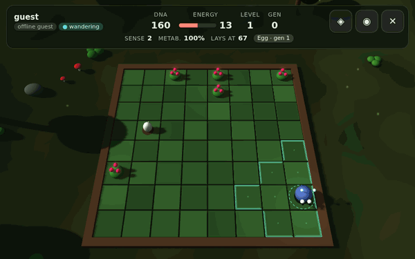
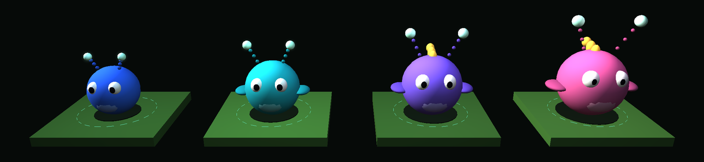
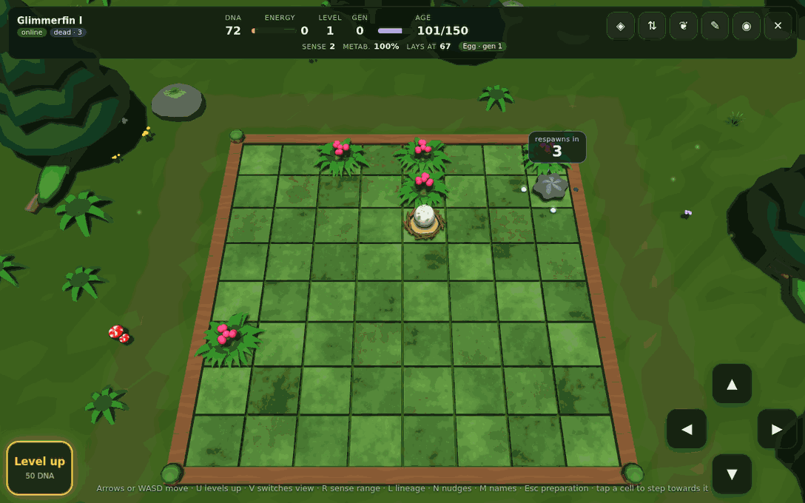
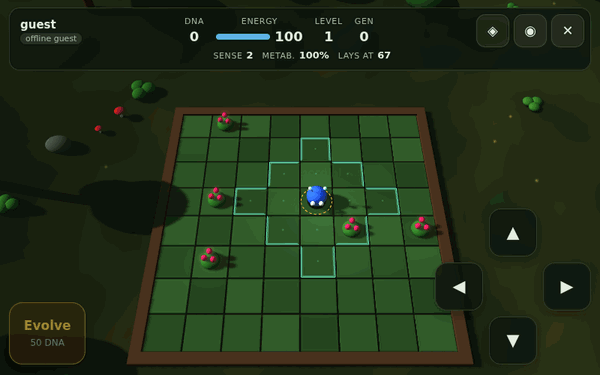
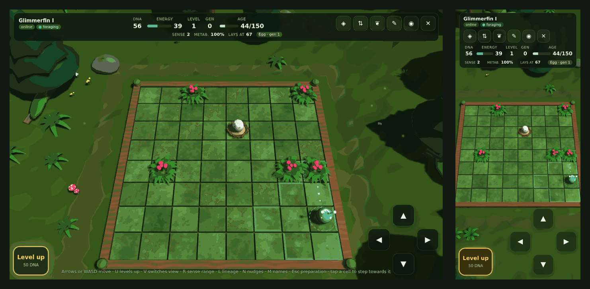
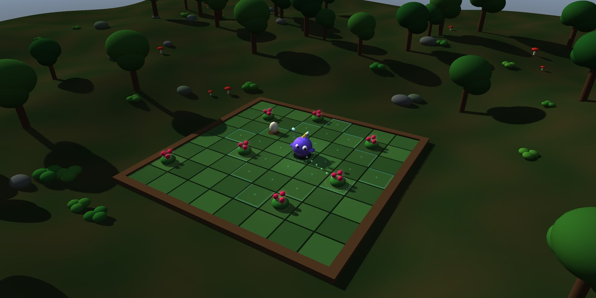
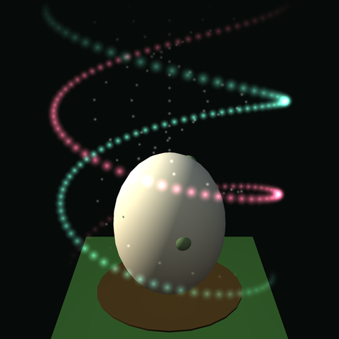

  

<em>A creature starves, waits out its countdown and hatches from its own egg as the next generation. Captured from the game.</em>

<h1 align="center">Primordial Rise</h1>

<strong>Raise a lineage that lives, dies and evolves without you watching.</strong>

## What it is

Primordial Rise is an evolution game. A small creature forages a forest board, eats berries
for DNA, levels up, lays an egg carrying slightly mutated genes, and one day dies. Its egg
hatches as the next generation. You can steer it, or step away and let it fend for itself.
Over many generations the lineage changes, and those changes are what keep it alive.

It runs on PC (Windows and Linux) and in the browser, on desktop and phone.

## Highlights

### Evolution you can see

  

<em>Four stages of a lineage, rendered in the game's engine. Evolving adds fins, a crest and a tail, and a creature that senses farther grows longer antennae.</em>

Every creature carries genes. They decide how far it senses food, how fast it burns
energy and when it is ready to lay. Evolving changes its body, and genes shift a little
with every egg.

### Eggs and generations

  

<em>Death is not the end of a run: the creature waits out a short countdown and the lineage carries on from its egg.</em>

A creature that eats well lays an egg. When the creature dies, the egg hatches, and the
newborn inherits its parent's genes with a small mutation. The generation counter keeps
climbing, and so does the story of your line.

### A creature that forages on its own

  

<em>Left alone, the creature looks for food within its sense range and walks to the best bush it can find.</em>

Leave it be, and it keeps living: it senses nearby berries, judges which are worth the
walk and goes after them. Come back later to see how it fared while you were away.

### On your desk and in your pocket

  

<em>The browser build at desktop size and on a phone.</em>

The desktop builds run natively on Windows and Linux. The browser build fits a phone
screen, with touch controls.

### A small 3D forest

  

<em>The Forest Zone and the woods around it, rendered in the game's engine.</em>

The board sits in a living forest, with trees, ferns, toadstools and fireflies, and a sun
that casts real shadows.

## Play the demo

A free browser demo is live at
[primordial-rise.play.danielstephenson.dev](https://primordial-rise.play.danielstephenson.dev/).
Make an account, name your species, and come back later to see how your lineage fared.

Players can share their creatures and compare them on the community site,
[primordial-rise-community.play.danielstephenson.dev](https://primordial-rise-community.play.danielstephenson.dev/).

## What's next

Primordial Rise is in active development, with desktop builds for Windows and Linux.
News will be announced here first.

## Built with Strata

Primordial Rise is rendered with [Strata](https://github.com/Preponderous-Software/strata),
an open-source 3D engine from Preponderous Software. The same scene runs natively on the
desktop and as WebAssembly in the browser.

---

  
   
  Primordial Rise © 2022–2026 Daniel McCoy Stephenson. All rights reserved. 
  Every image on this page is a capture or render from the game itself.

